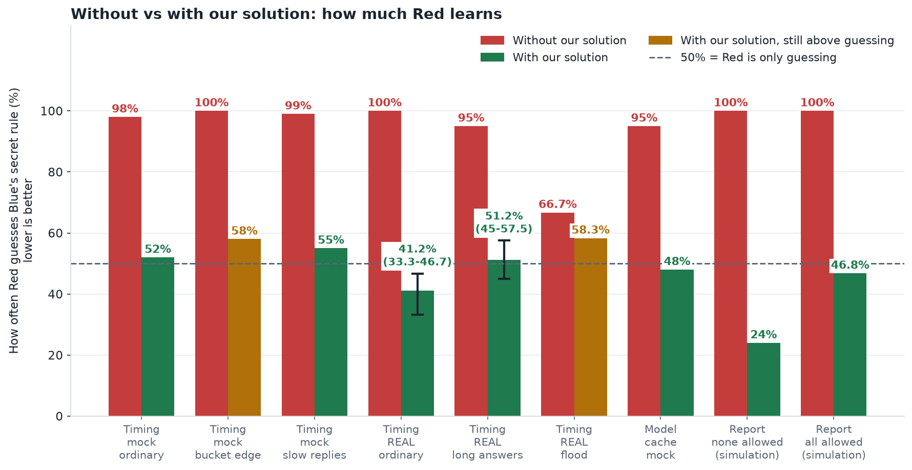

# Hide, Normalize, Prove

**Team Ctrl Alt Elite** · Bayora challenge: *Securing Adversarial AI Safety Testing Infrastructure*

Red-team attackers, a Blue-team private filter and a client LLM must share one sandbox. If Red can learn Blue's secret rule from anything it can see (timing, errors, cache, load, logs), the safety test is worthless.
**Hide, Normalize, Prove** closes those doors: Red is locked in its own network and always gets the same short reply at the same time (**hide** and **normalize**), and every event goes into a signed hash-chain audit (**prove**).
We built 11 attacks ourselves, measured each one with and without our solution, and report exactly what still leaks.

> Everything below was measured on one laptop, mostly with a mock model, plus small real-model (DeepSeek) runs. We do **not** claim "secure" or "zero leakage". Test settings were written down before each run (`prototype/PARAMS.md`).

## Try it after cloning (about 10 minutes)

All code lives in [`prototype/`](prototype/). Needs Python 3.11+. No API key and no Docker for steps 1 to 4.

**1. Install** (the first install takes about 4 minutes)
```
git clone https://github.com/MdTabish24/hide-normalize-prove.git
cd hide-normalize-prove/prototype
python -m venv .venv
.venv\Scripts\activate            # Linux / macOS: source .venv/bin/activate
python -m pip install -r eval/requirements.txt
```

**2. Quick checks (about 2 minutes)**
```
python -m pytest tests/test_play.py tests/test_room.py tests/test_blue_inline.py tests/test_pin_cpus.py -q
python attack_suite.py --only 3 4          # fake tokens + error messages: expect BLOCKED under window_hard
python -m eval.coarse_report               # report-extremes simulation: exact guess drops from 100% to 24% / 47%
```

**3. See it: the interactive walk-through**
```
python -m uvicorn dashboard.app:app --host 127.0.0.1 --port 8090 --no-access-log
```
Open `http://127.0.0.1:8090/play`: one button per attack, two panels (**without** and **with** our solution), one **Run simulation** button, **Next** for the next attack. More pages: `/room` (long cards), `/story`, `/why`, `/duel`, `/history`.

**4. Full test suite (3 to 4 minutes, close other apps: some tests measure timing)**
```
python -m pytest tests eval/tests -q -p no:cacheprovider
```

**5. Docker stack (optional, needs Docker Desktop)**
```
python init_env.py --fast                  # creates .env once (never commit it)
docker compose up --build -d               # default: window_hard + continued compute + batched audit
python manage.py configure                 # Blue sets its rule
python attack_suite.py --only 1 2 8        # network, files and secrets, log scan
python -m eval.hardening_check             # container hardening (needs the stack running)
```
Real DeepSeek runs (optional, your own key, costs tokens) and every other command: [`prototype/README.md`](prototype/README.md).

## Benchmark: 11 attacks, without and with our solution

**7 of 11 stopped, 4 reduced but not closed, 1 more group out of scope.** Labels: *mock* = fake model, *real* = DeepSeek small sample, *sim* = simulation, *weak setup* = a deliberately weakened copy, built to prove our test can see a leak. "50%" = Red is only guessing.



*Red bar = without our solution, green = with it, amber = with it but still above guessing (50%). Drawn from the saved result files by `python -m eval.make_charts`.*

### All 11 attacks in one table
| # | Attack | Without our solution | With our solution | Result | Reproduce |
|---|---|---|---|---|---|
| 1 | Open a direct door (network) | weak setup: 6 of 10 targets reachable | 10 of 10 blocked | **Stopped** | `attack_suite.py --only 1` (Docker) |
| 2 | Read files and secrets | weak setup: token, key and sealed rule file found | nothing found | **Stopped** | `--only 2` (Docker) |
| 3 | Fake tokens (10 tricks) | not measured (no weak gateway built) | 10 of 10 no effect | **Stopped** (no positive control) | `--only 3` |
| 4 | Error messages (12 kinds) | old policy: 3 different reply times | 1 reply, 1 time | **Stopped** | `--only 4` |
| 5 | Timing (real DeepSeek) | Red guesses 98 to 100% | normal prompts 33 to 47% (4 runs), long answers 45% and 57.5%, flood 58.3% | **Reduced** (bounded, not proven safe) | `REAL_MODEL_REPORT.md`; `python -m eval.real_suite` |
| 6 | Model cache | shared cache: 95% | own cache per run: 45 to 48% | **Stopped** | `--only 6` |
| 7 | Report extremes (sim) | exact guess at 0 and 16: 100% | coarse mode: 24% and 47% | **Reduced** | `python -m eval.coarse_report` |
| 8 | Log and file search | careless Blue: rule and prompt found | 18 files: only hashes | **Stopped** | `--only 8`; `python -m eval.weak_controls --only 8` |
| 9 | Flood the guard (mock) | Blue's slowest 5%: 911 to 1811 ms | 909 to 910 ms; audit queue 10,000 to 35 | **Stopped** (one run) | `--only 9` |
| 10 | CPU kept busy (mock) | 32 of 60 replies late (earlier run) | 3 runs: no shift, but the control also showed none | **Reduced** (not proven) | `--only 9b` |
| 11 | Flood from inside Docker | slowest 5%: 915 to 2519 ms | 912 to 1697 ms (another run: 909 to 913) | **Reduced** (varies per run) | `--only 9c` (Docker) |
| (out of scope) | Kernel escape, hardware and GPU channels, compromised gateway | not tested | Red's container: no privileges, read-only disk, no Docker socket (5 of 5 containers pass) | **Not covered** | `python -m eval.hardening_check` |

**Where a small leak remains**
- **Timing with long answers and floods:** about 58% with the real model (interval 45.7 to 69.9%), so bounded, not proven safe.
- **Report extremes:** reduced in simulation only, not tested with the real model.
- **CPU-load slip and Docker flood:** the measurements change from run to run, so we do not call them closed.
- **Red's feedback:** hiding more means weaker attacks. Exact feedback finds a planted bypass in 7 probes, our opt-in meter needs about 60. The default report was not measured.

## Timing evidence (Round 2)

How often Red guesses Blue's secret rule (A or B) from the reply time alone. 50% means Red is only guessing.

**Mock model, live gateway, 200 unseen runs per case**

| Case | No protection | Old policy (buckets) | Our policy (fixed window) |
|---|---:|---:|---:|
| Ordinary | 98% | 58% | **52%** |
| Reply near a bucket edge | 100% | 98% | **58%** |
| Very slow replies | 99% | 100% | **55%** |
| Deadline near | not measured | 100% | **49%** |
| Deadline far | not measured | 98% | **51%** |

**Real DeepSeek model, 40 to 60 unseen runs per case**

| Case | No protection | Old default policy | Our policy (fixed window, compute continues) |
|---|---:|---:|---:|
| Ordinary prompts | 100% (2 runs) | not measured | **33.3%, 43.3%, 41.7%, 46.7%** (4 runs) |
| Long answers | 95.0% | not measured | **45.0%, 57.5%** (2 runs) |
| Flood of requests | not measured | 66.7% | **58.3%** |

Our policy takes almost every case close to guessing. Not all: the bucket-edge case (58%), long answers (57.5%) and the real flood (58.3%) stay a little above 50%, and with 40 to 60 test runs the intervals are about 12 points wide each way. So this is a measured reduction, not a proof that nothing leaks. Details: [`REAL_MODEL_REPORT.md`](prototype/REAL_MODEL_REPORT.md), [`FINAL_REPORT.md`](prototype/FINAL_REPORT.md). The Round 1 timing table is gone from this page (it described the old bucket simulation): see [`ROUND1_README.md`](ROUND1_README.md).

Full evidence: [`FINAL_REPORT.md`](prototype/FINAL_REPORT.md) (open problems), [`REAL_MODEL_REPORT.md`](prototype/REAL_MODEL_REPORT.md) (real-model tables), [`PARAMS.md`](prototype/PARAMS.md) (settings fixed before each run), [`VIDEO_TRANSCRIPT.md`](prototype/VIDEO_TRANSCRIPT.md).

## Team Ctrl Alt Elite

| Role | Member | GitHub |
|---|---|---|
| **Team Leader** and **UI/UX Designer** | Sohail | [@Sohailforreal](https://github.com/Sohailforreal) |
| **AI Engineer** | Tabish | [@MdTabish24](https://github.com/MdTabish24) |
| **Backend Developer** | Imran | [@Imran65545](https://github.com/Imran65545) |

Built together by all three of us.
